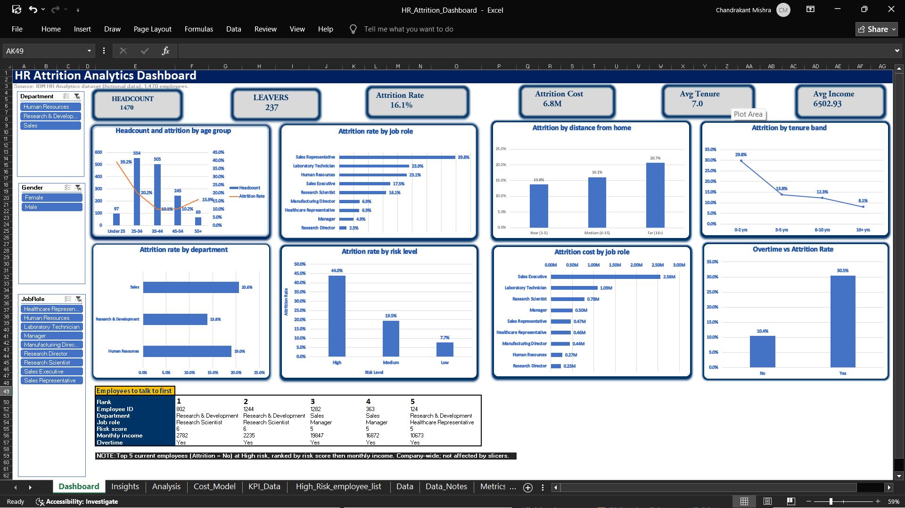

# HR Attrition Analytics Dashboard (Excel)

An interactive Excel dashboard that shows why employees leave, where the cost is highest, and which current employees HR should talk to first. Built on the IBM HR Analytics dataset (fictional data, 1,470 employees).

## Files
- [Full write-up (PDF)](HR_Attrition_Write-up.pdf)
- [HR_Attrition_Dashboard.xlsx](HR_Attrition_Dashboard.xlsx): the full workbook
- dashboard.png: dashboard screenshot

## Key results
- Overtime: 30.5% attrition vs 10.4% without
- Risk score: High 44.0%, Medium 19.5%, Low 7.7%
- Estimated attrition cost: about 6.8M a year (assumes replacement cost = 50% of annual salary)

## Tools
Excel 2019: Power Query, pivot tables, slicers, COUNTIFS, INDEX/MATCH, what-if analysis.
